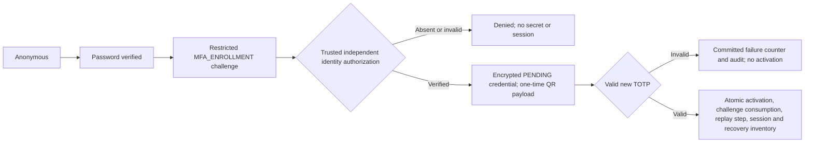
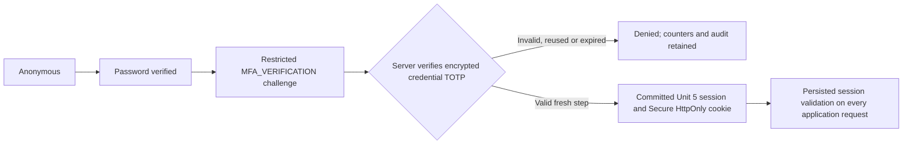
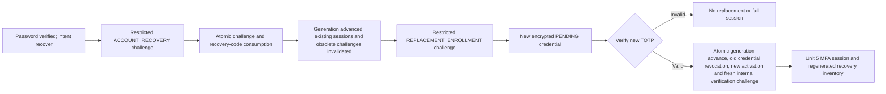

# Phase 2 Unit 6: mandatory backend MFA

Current Unit 10B additions are documented in [phase2_unit10b.md](phase2_unit10b.md):
scoped session inventory/targeted revocation and resilient one-time code delivery.
The user deferred recent-TOTP freshness requirements; mandatory MFA, enrollment
authorization and generation/recovery semantics below remain unchanged.

Unit 6 replaces password-only backend authentication. Every canonical role must
complete TOTP before receiving a persisted MFA session. There is no Super Admin,
legacy ADMIN, seed-password, resource-owner or frontend-compatibility exemption.
No frontend file is changed. This is not a production-ready coordinated release:
the current frontend expects a password-only bearer response and localStorage;
it cannot complete the new cookie/challenge/CSRF workflow until Unit 8.

## State diagrams and HTTP contract

Initial enrollment:



Enrolled-user login:



Recovery, equally strict for Super Admin:



Endpoints:

| Endpoint | Contract |
|---|---|
| GET `/auth/csrf` | Exact allowed HTTPS Origin required; returns signed CSRF token and secure HttpOnly CSRF cookie |
| POST `/auth/login` | Email/password and optional `intent: login/recover`; returns only `next_step`, challenge ID and restricted secret |
| POST `/auth/mfa/enroll` | Restricted enrollment ticket; generates an encrypted pending credential only after authorization; returns provisioning URI and identical QR-compatible `qr_payload` once |
| POST `/auth/mfa/enroll/verify` | Ticket plus six-digit TOTP; activates only on success; session is delivered only by cookie; recovery codes returned only on issuance |
| POST `/auth/mfa/verify` | MFA_VERIFICATION ticket plus six-digit TOTP; full persisted session on success |
| POST `/auth/recovery/verify` | ACCOUNT_RECOVERY ticket plus recovery code; returns only a restricted replacement ticket, never a session |
| GET `/auth/me` | Requires current persisted MFA session |
| POST `/auth/logout` | Revokes current session atomically and clears cookies |
| POST `/auth/logout-all` | Advances generation and invalidates all prior sessions/challenges atomically, then clears cookies |

Tickets contain `challenge_id` and `challenge_secret`; the latter is a restricted
capability, not an application bearer token. Verification adds `code`. Extra
challenge payload claims are rejected. Password-success responses contain no
`access_token`, authenticated session or MFA claim. Full-session responses contain
`authenticated`, fresh session-bound `csrf_token`, and recovery codes only when
newly issued. Neither JWT nor session ID is returned in JSON.

Authentication responses use no-store caching. Malformed body errors are generic
and do not echo passwords/OTP inputs. Unknown accounts, wrong passwords, inactive
accounts and unmapped identities get the same authentication-failure response.
Unknown accounts execute dummy Argon2 verification using a process-local random
negative-test hash, never a fallback user credential. MFA purpose becomes visible
only after successful password verification; failed capabilities give neutral
responses. Rate denials return generic 429, infrastructure failures generic 503.

## Independent first-enrollment assurance

Repository inspection found demo seed passwords and ordinary login, but no trusted
identity onboarding/reset verifier. None is invented. `create_app()` provides no
default enrollment authorizer. A deployment-owned, server-configured
`EnrollmentAuthorizer.authorize_enrollment()` must return a genuinely verified
`EnrollmentAuthorization` for the exact user, challenge, security generation,
expiry and independent approval reference/operator. The same provider is checked
again at confirmation, allowing revoked/expired authorization to stop activation.

The protocol and bound fields are a validation contract, not proof that an
independent human was verified. The integration must authenticate the operator,
verify identity out of band, prevent self-approval, check revocation and bind the
approved browser challenge through a trusted channel. Role, known password,
request JSON, a different operator-name string, or an audit row alone is not that
assurance. HTTP cannot choose/configure the provider. Tests use a clearly fictional
test-only verifier; no permissive verifier ships in application services.

An operator-controlled bootstrap therefore requires reviewed canonical identity
mapping, independently verified subject/operator identity, authenticated approval
evidence, expiry/revocation controls and a trusted provider integration before
enrollment can succeed. With no provider, password verification can create only a
restricted challenge; secret generation and activation fail closed, including for
initial Super Admin. No actual approval reference, operator ID or user mapping is
provided or invented here. No real account was enrolled during implementation.

Replacement enrollment is independently rooted in the already committed,
password-and-recovery-code verification receipt for its exact ticket/generation.
It does not accept an initial-enrollment grant or password-only substitute.

## TOTP, replay and competing enrollment

PyOTP 2.10.0 implements interoperable RFC TOTP: six digits, SHA-1 and default
30-second interval. `MFA_TOTP_INTERVAL_SECONDS` is configurable (15–120 seconds),
and `MFA_TOTP_CLOCK_SKEW_STEPS` is constrained to 0 or 1 (default 1). Verification
compares all permitted steps without accepting recovery strings as OTPs, then
passes the accepted step to Unit 5. See [PyOTP documentation](https://pyauth.github.io/pyotp/).

Secrets use CSPRNG base32 material and Unit 5 AES-256-GCM, including user,
credential and key-version authentication binding. Neither plaintext secret nor
provisioning URI is stored. The authorized response's URI is directly QR-encodable;
rendering a QR image belongs to Unit 8. A generated credential remains PENDING.
Repeated start for the same ticket cannot redisclose its secret. Superseding a
pending enrollment retains revoked history and invalidates competing challenges.

All workflows use Unit 2's shared user-row lock through Unit 5 `locked_state`.
Sensitive rows are locked/reloaded; Unit 5 conditionally consumes challenge and
strictly newer TOTP step in the same transaction as session and audit. The partial
unique active/pending indexes remain unchanged. Concurrent cooperating operations
therefore cannot activate multiple current credentials or consume a step twice.
Read checks do not substitute for the conditional write. Enrollment proof must
use the credential enrolled for that challenge, not an old credential.

## Recovery and atomic transitions

Recovery inventory contains independent, unique 192-bit CSPRNG values. Only Unit 5
Argon2id hashes are stored. Values are displayed only in successful initial or
replacement completion responses, never logged/audited/retrieved later. Active
inventory lookup is bounded at 16 and checks current generation and unused state;
multiple matching hashes fail closed. Public recovery accepts no internal code ID.
Unit 5 re-verifies and atomically consumes the selected code under the user lock.

Code consumption, recovery-challenge consumption, generation change, session
invalidation, replacement ticket and receipt commit together. No recovery response
authenticates. The old credential remains active during pending replacement, but
it cannot complete replacement enrollment. On successful new TOTP, a second atomic
generation change invalidates sessions created during that pending period; the old
active credential is revoked and retained, new credential activated, and a fresh
internal MFA_VERIFICATION challenge allows Unit 5 session issuance at the new
generation. That challenge is never exposed to the client. New replay reservation,
session, inventory and all required audits share the activation transaction.

Two generation advances are intentional: one at recovery authorization and one at
credential replacement. Old recovery inventory is generation-invalid, retained
as evidence, and cannot be reused. Losing a response does not redisclose secret
material; operational recovery must use a fresh authorized workflow.

## Authentication dependency and authority separation

`get_current_user()` now requires a signed `sub`/`sid` transport token and persisted
Unit 5 session validation with idle touch in an explicit Session on the existing
bind. It checks active/canonical identity, generation, credential, consumed
verification chain, MFA evidence, expiry and revocation. Legacy JWTs lacking valid
persisted SID are rejected, even with `mfa: true`. Missing/corrupt identities fail
closed. Current User is reloaded from the database; JWT role claims are unused.
`request.state.principal` contains the validated Unit 3-compatible session context.

Unit 4 consumers remain unchanged and still revalidate current Unit 3 authority
inside sensitive transactions. Authentication does not grant administration or
business-data permission. `evaluate_access()`, grants/field policies, resource
ownership and the separately deferred Option B change are untouched.

## Cookie, CSRF, CORS and proxies

The browser transport is `__Host-gnosis_session`: Secure, HttpOnly, SameSite=Strict,
Path=/ and no Domain. HTTPS is required. Session JWT lifetime is bounded by the
persisted absolute lifetime. Default/short signing keys and algorithms other than
the configured HS256 contract fail closed; provision a managed high-entropy JWT
key rather than the old CHANGEME value.

CSRF uses a separately managed `AUTH_CSRF_KEY` (base64 32 bytes), HMAC signatures,
expiry, random nonce, exact Origin and session binding. Both CSRF cookie and custom
`X-CSRF-Token` must match. An anonymous token cannot be reused after session
issuance; completion returns and sets a fresh session-bound token. CSRF cookies
are also Secure/HttpOnly/Strict; the frontend should keep the returned header value
in memory and refresh via `/auth/csrf`, never localStorage. Every unsafe cookie-
authenticated application operation and every public authentication POST enforces
CSRF. See [OWASP signed double-submit guidance](https://cheatsheetseries.owasp.org/cheatsheets/Cross-Site_Request_Forgery_Prevention_Cheat_Sheet.html).

`AUTH_ALLOWED_ORIGINS` defaults to empty. Configure exact HTTPS origins, not
wildcards, URL paths or guessed development/production hosts. CORS allows only
those origins with credentials and explicit methods/headers. SameSite=Strict also
requires a compatible same-site browser deployment; allowing an unrelated origin
in CORS alone does not make cross-site cookies work. TLS/origins/topology must be
reviewed before cutover; no production addresses are assumed here.

`AUTH_ALLOW_BEARER_SESSIONS` defaults false. Its explicit non-browser option still
requires valid signed SID and all persisted MFA state, disallows Origin-bearing
requests and supplies no password-only compatibility fallback. No public endpoint
issues a JSON bearer token. Existing consumer regression fixtures explicitly opt
into this transport with already-enrolled disposable session records. The browser
must use cookies; enabling this option cannot make the old frontend login work.

Source throttling uses the ASGI peer by default. Every forwarded header from an
untrusted peer is ignored. `AUTH_TRUSTED_PROXY_CIDRS` defaults empty and rejects
all-address networks. Only explicitly trusted peers may supply a bounded,
validated X-Forwarded-For chain; parsing walks from the trusted edge to the nearest
untrusted source. Trusted X-Forwarded-Proto=https can establish external HTTPS.
Malformed trusted chains fail closed. Forwarded headers must be stripped/replaced
at the trusted edge. Run Uvicorn with `--no-proxy-headers` so automatic upstream
rewriting cannot bypass the application's peer checks; any alternative server
normalization requires an explicit equivalent trusted-proxy deployment review.

## Throttling, audit and failure behavior

Unit 5 shared database counters are committed before password/OTP/hash work.
Category-specific account/challenge budgets default to 5 per 300 seconds; the
shared source budget defaults to 60 per window through
`AUTH_SOURCE_RATE_LIMIT_THRESHOLD`. Failures cannot roll back those protective
counters. Exhausted challenge attempts are also committed before denial. Database,
key or rate-storage failures never disable protection or issue a session.

Password success/failure, challenges, enrollment authorization/start/completion,
TOTP verification/failure, recovery consumption/authorization, replacement,
inventory issuance/regeneration, sessions/revocations/generation changes and rate
enforcement have audit evidence. Rate enforcement additionally emits an unscoped
MEDIUM SecurityEvent linked to its audit, visible only through the existing
organization monitoring boundary. No new risk/detection engine is introduced.

Successful sensitive transitions and required audit writes commit atomically.
Failures that intentionally count attempts return an internal denial outcome so
their counter/audit transaction commits before HTTP denial. Unexpected failures
escape and roll back the security mutation. Cookie issuance occurs only after
commit. No best-effort committing audit helper is used. State/audit failures return
neutral unavailability without stack traces or sensitive query data to clients.
Audit context contains only service-selected IDs, causes and approval provenance;
no password, OTP, recovery value, URI, TOTP secret, bearer token or key is recorded.

## Last-Super-Admin operational boundary

Super Admin uses the same password plus single-use code plus new TOTP recovery
flow as everyone else. There is no shared recovery code, seed bypass, role bypass,
MFA-disable endpoint or online admin reset. Before cutover, maintain independently
controlled offline custody of recovery material and a separately approved
last-Super-Admin recovery procedure. If every valid TOTP and recovery code is lost,
this implementation deliberately cannot perform an online recovery.

A safe offline procedure requires independently authenticated subject identity,
separate authorized reviewers/custodians, immutable approval evidence, controlled
maintenance access, generation/session invalidation, audited credential lifecycle
changes and tested backup/key custody. The repository has no trusted infrastructure
to attest those controls, so no executable reset procedure or fabricated approval
mechanism is supplied. Its separately reviewed implementation is an operational
prerequisite, not permission to edit database rows or weaken enforcement.

## Schema, tests and deployment gates

No new schema is needed: the existing Unit 5 challenge/credential/generation state
and strict audit receipts represent these workflows. Migration 0008 is unchanged;
no migration or identity backfill was applied. No real users, credentials,
enrollment secrets, recovery codes or sessions were created. All workflow activity
is inside the unchanged guarded in-memory test launcher with fictional identities
and disposable managed-key substitutes.

Old HTTP regressions now declare already-enrolled test fixtures and validate the
real session-backed dependency; no dependency bypass or legacy acceptance was
introduced. Their explicit canonical roles are test declarations, never inferred
from ownership/legacy roles. The governance end-to-end tests perform real HTTP
password and TOTP verification against disposable pre-enrolled fixtures. The
Unit 5 password-only-compatibility assertion is superseded by restricted-challenge
and no-session assertions. Unmapped/corrupt identity expectations now require 401
before administrative authorization. Prior Unit 1–5 policy/schema/atomicity tests
and the launcher/connection guards remain intact.

SQLite tests cover deterministic clocks, real TOTP, replay, expiry, duplicate
consumption, rollback, shared counters, origin/CSRF/cookies and proxy boundaries.
The cooperating-worker test serializes its single in-memory DBAPI connection;
it is not a real PostgreSQL multi-connection concurrency proof. Unit 5's offline
locking/UPSERT/migration checks remain. A separately approved disposable PostgreSQL
concurrency test is still required before deployment, including competing login,
enrollment, recovery and revocation operations.

Deployment gates: reviewed identity mappings and migration application; real
independent enrollment-authorizer integration; separate managed JWT/encryption/
rate-HMAC/CSRF keys and rotation custody; explicit HTTPS origins and proxy topology;
clock synchronization; reviewed per-category limits and recovery inventory count
(`MFA_RECOVERY_CODE_COUNT`, default 10); offline last-admin recovery controls; and
Unit 8 frontend integration. The existing frontend is temporarily incompatible;
backend enforcement must not be disabled to accommodate it.

```powershell
.\.venv\Scripts\python.exe -u -B backend/scripts/run_phase1_tests.py backend/tests/test_test_isolation.py -q
.\.venv\Scripts\python.exe -u -B backend/scripts/run_phase1_tests.py backend/tests/test_mfa_workflows.py -q
.\.venv\Scripts\python.exe -u -B backend/scripts/run_phase1_tests.py backend/tests -q
git diff --check
```

Final verification: baseline 561 passed; focused Unit 6 suite 46 passed; complete
backend suite 607 passed with the same two pre-existing Starlette/Pydantic warnings.
Isolation safeguards passed 7/7. The final full run reported 569 guarded engines,
568 in-memory connections and 6 intentionally blocked unsafe-target probes.
`git diff --check` passed. PyOTP 2.10.0 was added/installed in the workspace virtual
environment; no frontend installation, build or lockfile change was performed.

An intermediate regression run had six superseded Unit 4 identity-denial
expectations (now 401 at authentication rather than 403/404/ORM error). The new
logout-all clock test also required a consistent deterministic route clock.
These were corrected without changing business authorization or removing tests.

The Git-visible baseline contained 179 files. Unit 6 preserves 160 byte-for-byte,
updates the following 19 intended authentication/fixture files and adds 6 files.
No existing file was deleted. Prior Unit 4 production consumers, Unit 5 primitives,
all migrations, business authorization and frontend files remain unchanged.

## Exact Unit 6 file inventory

| File | Change |
|---|---|
| [backend/tests/test_administrative_consumers.py](D:/projects/gnosis/backend/tests/test_administrative_consumers.py) | Updated |
| [backend/tests/test_authentication_infrastructure.py](D:/projects/gnosis/backend/tests/test_authentication_infrastructure.py) | Updated |
| [backend/app/api/deps.py](D:/projects/gnosis/backend/app/api/deps.py) | Updated |
| [backend/app/api/v1/auth.py](D:/projects/gnosis/backend/app/api/v1/auth.py) | Updated |
| [backend/app/core/config.py](D:/projects/gnosis/backend/app/core/config.py) | Updated |
| [backend/app/core/security.py](D:/projects/gnosis/backend/app/core/security.py) | Updated |
| [backend/app/main.py](D:/projects/gnosis/backend/app/main.py) | Updated |
| [backend/app/schemas/auth.py](D:/projects/gnosis/backend/app/schemas/auth.py) | Updated |
| [backend/requirements.txt](D:/projects/gnosis/backend/requirements.txt) | Updated |
| [backend/tests/conftest.py](D:/projects/gnosis/backend/tests/conftest.py) | Updated |
| [backend/tests/test_access_grants.py](D:/projects/gnosis/backend/tests/test_access_grants.py) | Updated |
| [backend/tests/test_access_requests.py](D:/projects/gnosis/backend/tests/test_access_requests.py) | Updated |
| [backend/tests/test_ai_investigator.py](D:/projects/gnosis/backend/tests/test_ai_investigator.py) | Updated |
| [backend/tests/test_audit_and_detection.py](D:/projects/gnosis/backend/tests/test_audit_and_detection.py) | Updated |
| [backend/tests/test_auth.py](D:/projects/gnosis/backend/tests/test_auth.py) | Updated |
| [backend/tests/test_authorization.py](D:/projects/gnosis/backend/tests/test_authorization.py) | Updated |
| [backend/tests/test_console_and_incidents.py](D:/projects/gnosis/backend/tests/test_console_and_incidents.py) | Updated |
| [backend/tests/test_governance_e2e.py](D:/projects/gnosis/backend/tests/test_governance_e2e.py) | Updated |
| [backend/tests/test_grant_lifecycle.py](D:/projects/gnosis/backend/tests/test_grant_lifecycle.py) | Updated |
| [backend/app/services/authentication_transport.py](D:/projects/gnosis/backend/app/services/authentication_transport.py) | Added |
| [backend/app/services/mfa_workflows.py](D:/projects/gnosis/backend/app/services/mfa_workflows.py) | Added |
| [backend/app/services/totp_verification.py](D:/projects/gnosis/backend/app/services/totp_verification.py) | Added |
| [backend/docs/mandatory_mfa.md](D:/projects/gnosis/backend/docs/mandatory_mfa.md) | Added |
| [backend/tests/authentication_support.py](D:/projects/gnosis/backend/tests/authentication_support.py) | Added |
| [backend/tests/test_mfa_workflows.py](D:/projects/gnosis/backend/tests/test_mfa_workflows.py) | Added |
